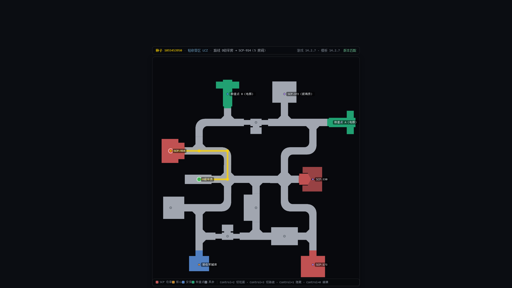
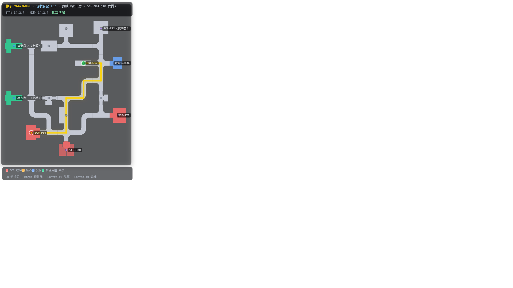
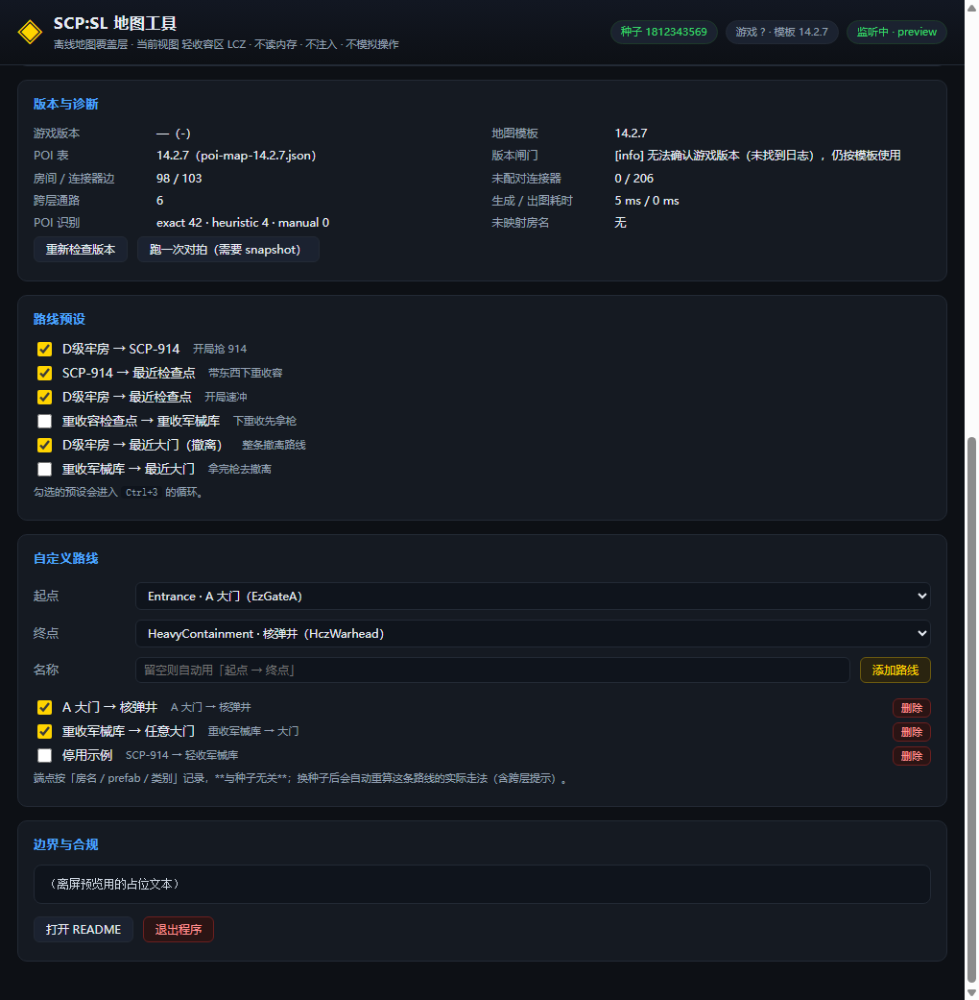

# SCPSL 地图工具 · SCPSL Map Overlay

> **SCP: Secret Laboratory 的离线地图覆盖层**：进游戏敲一次 `seed`，整局设施地图、
> 48 个点位、路线指引就以**置顶半透明、鼠标穿透**的窗口悬浮在游戏画面上。
>
> **非官方工具**，与 Northwood Studios 无关。不读内存、不注入、不联网、不做实时定位。


---

## 特性

| | |
|---|---|
| 🗺️ **真实地形地图** | 用游戏内 SCP-079 地图同款的**官方房间图标**渲染：走廊、异形房、圆形焚化炉都是真实形状 |
| 🧭 **路线指引** | 6 条内置路线 + 自定义路线；路线**贴着地形走**：路口直角转弯、绕开炉坑与内墙、绝不穿墙；跨层路线带"乘检查点电梯下到重收容区"这类提示 |
| 📍 **48 个 POI** | D 级牢房、SCP-914、军械库、检查点、大门、核弹井……重要区域按分类上色（SCP 收容 / 核心 / 安保 / 检查点） |
| ⚡ **快** | 生成一局布局 6–7 ms，全程离线本地计算 |
| 🖥️ **不打扰** | 置顶 + 透明 + 鼠标穿透；透明度、缩放、显隐全在设置里；托盘常驻 |
| 🖥️→🖥️ **多显示器跟随** | 游戏在哪个屏，地图就跟到哪个屏（设置里可固定回主屏） |
| 🔍 **悬停查房** | 编辑模式下鼠标悬停任意房间：显示名称 / 分区 / prefab / 坐标 / 连接器数 / 是否在路线上 |
| 📤 **一键导出 PNG** | 当前地图（含路线与起终点）存成图片，文件名自带种子与视图 |
| 🕘 **种子历史** | 最近 20 局种子（含来源与所在服务器），点一下就能回看那张图 |
| 📊 **状态条看本局** | 顶部状态条直接显示「设施中 / 主菜单 / 加载中」、本局服务器、节日活动；还是上一局种子时会标「上一局」并提醒重敲 |
| 📖 **内置快速上手** | 设置页顶部教程随时可看（可收起，记住你的选择）；本局没读到种子时标题行自动变 ⚠，不用翻文档 |
| 🎮 **节日活动自适应** | 检测游戏节日活动（圣诞 / 万圣节 / 愚人节），自动换对应布局 |
| ⌨️ **热键自由** | 支持 **1–3 键**任意组合（单键 / 双键 / 三键），带游戏按键冲突提示 |
| 🔄 **自动跟局** | 换图自动读新种子；自定义路线每次换种子自动重算；游戏版本与模板不匹配时红条提醒 |

单分区视图（轻收容区 · D级牢房 → SCP-914）：



编辑模式悬停查房（鼠标指着哪个房间，就显示它的名字 / 分区 / prefab / 坐标）：



---

## 安装与上手

1. 到 **[Releases](https://github.com/5h1iky/SCPSL-Map-Overlay/releases)** 下载最新版本：
   - `SCPSL-Map-Overlay-<版本>-setup.exe` —— 安装版（NSIS）
   - `SCPSL-Map-Overlay-<版本>-portable.exe` —— 免安装版，直接双击
   > Windows SmartScreen 可能提示"未知发布者"——程序**未做代码签名**，选「仍要运行」即可。
   >
   > 安装版从 0.3.1 起改为**按机器安装**（会弹一次 UAC）：可以自选安装目录（D 盘 / E 盘都行）；
   > 桌面和开始菜单都会建快捷方式，开始菜单里还有「卸载」；也可以在 **设置 → 应用** 里卸载。
2. 首次运行会弹出**使用前必读**（写清了这工具做什么 / 不做什么）。
3. 进入游戏，**显示模式必须是"无边框窗口"**（独占全屏下任何第三方窗口都盖不上去，这是 Windows 机制）。
4. 在游戏聊天框敲一次 `seed`。
5. 按 `Ctrl+1` —— 地图、点位、路线就出来了。

> ⚠️ **每开新一局都要重新敲一次 `seed`**：地图完全由种子决定，工具不会替你敲，也读不到你没有敲出来的种子。
> 没敲时它会沿用上一局的地图（状态条会标「上一局」，设置页教程卡也会变 ⚠）。

程序常驻托盘；关掉设置窗口不会退出。

---

## 热键（默认值，可在设置页修改）

| 热键 | 动作 |
|---|---|
| `Ctrl+1` | 显示 / 隐藏覆盖层 |
| `Ctrl+2` | 循环视图：全设施 → LCZ → HCZ → EZ → 地表 |
| `Ctrl+3` | 循环路线预设（只循环你在设置里勾选的） |
| `Ctrl+4` | 循环缩放档位 |
| `Ctrl+5` | 强制重读种子（兜底） |
| `Ctrl+0` | 编辑模式：取消鼠标穿透，可拖动 / 滚轮缩放 / **悬停查房** / 右键复位 |
| `Ctrl+6` | 导出当前地图为 PNG |

**改热键**：设置页点一下热键框，按下想要的组合即保存——**1 到 3 键都行**
（如 `F6`、`Ctrl+7`、`Ctrl+Shift+8`）；`Esc` 取消，`Del` 清空（停用该热键）。
录入期间全局热键会临时停用，避免按键被系统抢走。
单键热键会在所有程序里抢走那个键（包括游戏内打字），设置页会黄字提醒。

---

## 设置一览

- **整体透明度** —— 地图与上下状态条同步变化
- **缩放 / 自动适配 / POI 标签 / 重要区域分类上色**
- **全设施视图显示地表** —— 地表只有一个房间，默认缩成底部小条；可隐藏
- **智能显隐** —— 进游戏设施自动显示地图，回主菜单自动隐藏（默认关，手动热键永远优先）
- **显示器** —— 默认"自动跟随游戏窗口"（游戏在哪个屏地图跟到哪）；也可固定主屏
- **种子历史** —— 最近 20 局，点条目即回看；可一键清空
- **自定义路线** —— 选起点终点即可（如「A 大门 → 核弹井」），端点与种子无关，换图自动重算
- **日志路径 / 手动种子 / 开机自启 / 启动时显示**



---

## 常见问题

**双击后没窗口、进程一闪就没了？**
个别机器（装了某些主动防御软件）Chromium 沙箱起不来。安装包创建的快捷方式已自带
`--no-sandbox` 参数，用快捷方式启动即可；或给 exe 快捷方式手动加上这个参数；
或设置用户环境变量 `ELECTRON_DISABLE_SANDBOX=1`。把程序加入安全软件信任区后可去掉。

**想装到 D 盘 / 桌面没有快捷方式 / 怎么卸载？**
0.3.1 起安装包按机器安装（安装时弹一次 UAC）：默认装到 `C:\Program Files`，但可以点「浏览」
自选任意盘；桌面和开始菜单都会建快捷方式，开始菜单里另有「卸载 SCPSL 地图工具」。
也可以在 **设置 → 应用** 里卸载。旧版（0.3.0 及以前）是按用户安装，卸载入口在
`%LOCALAPPDATA%\Programs\scpsl-map-overlay`。

**鼠标每隔几秒顿一下？**
0.3.0 的多屏跟随每 3 秒启动一次 PowerShell 探测游戏窗口（单次约 2.3 秒），单屏机器上纯属浪费。
0.3.1 已改成：**单显示器完全不探测**；多屏时 30 秒一次（没开游戏退避到 2 分钟），且只在覆盖层显示时探测。
若仍卡顿，把设置里的「显示器」改为「固定在主显示器」即可彻底停掉这项功能。

**地图是旧的 / 红条警告？**
右上角红条 = 游戏版本与地图模板版本不匹配（当前按 14.2.7 校准）。此时布局仅供参考。

**状态条显示"上一会话"？**
当前这局的种子还没从日志读到（新开一局还没敲 `seed`），工具回退用了上一局的日志
（`Player-prev.log`）——顶个用，但那是上一张图。进游戏后敲一次 `seed` 就会切成本局的。

**为什么没有我的实时位置？**
实时定位需要读游戏进程内存——本工具**不做**（见下）。路线是"从起点到终点怎么走"，
你在哪需要你自己对照。

---

## 设计边界（请先读）

- ✅ 只读取游戏自己写的日志（`Player.log` / `ServerLogs`）与按键配置（用于热键冲突提示）
- ✅ 多显示器跟随时枚举系统窗口标题，仅用于定位游戏窗口在哪块屏幕（**不读取窗口内容**）
- ✅ 静态布局 + 静态 POI 的路线计算
- ❌ 不读 / 不写游戏内存，不注入 DLL，不 hook
- ❌ 不模拟键鼠输入，不拦截 / 修改网络流量
- ❌ 不做"从我当前位置实时导航"

> ⚠️ **公共服务器**：请自行确认服务器规则是否允许外部地图辅助工具；是否使用由你自行判断并承担后果。

---

## 从源码构建

```powershell
npm install        # Electron 38 + electron-builder
npm start          # 开发运行
npm run dist       # 打包（NSIS 安装包 + 免安装版，输出到 dist\）
```

国内网络建议先设镜像：

```powershell
$env:ELECTRON_MIRROR = 'https://npmmirror.com/mirrors/electron/'
$env:ELECTRON_BUILDER_BINARIES_MIRROR = 'https://npmmirror.com/mirrors/electron-builder-binaries/'
$env:npm_config_registry = 'https://registry.npmmirror.com'
```

> `node_modules/`、`dist/`、日志与开发工具不入库；打包需 `asar: false`
> （生成器要用 Node ESM 动态加载模板 JSON，asar 内路径读不了）。

---

## 许可与署名

- **本仓库自有代码**（`src/`、`data/poi-map-14.2.7.json` 等）：[Apache-2.0](LICENSE)
- **房间图标**（`assets/room-icons/*.png`、`data/room-icons.json`）：
  > Room icons © Northwood Studios, licensed under [CC BY-SA 3.0](https://hub.scpslgame.com/index.php?title=Wiki:Licensing).
  > Changes: masked to solid white and recolored per zone at runtime.
- **离线地图生成器**（`data/vendor/map-seed/`，来自
  [kldhsh123/scpsl-map-seed](https://github.com/kldhsh123/scpsl-map-seed)）：
  以原样 vendored，保留其原始 `LICENSE` 与 `README`。该上游项目内部许可证声明存在不一致
  （MIT / Apache-2.0 / All rights reserved），**再分发前请与原作者澄清**——详见 [NOTICE.md](NOTICE.md)。
- 详细出处与修改声明见 **[NOTICE.md](NOTICE.md)**。

**商标**：SCP: Secret Laboratory 及相关名称、标识归 Northwood Studios 所有。
本程序不是官方工具，与 Northwood Studios 无任何关联，不使用其 logo。
